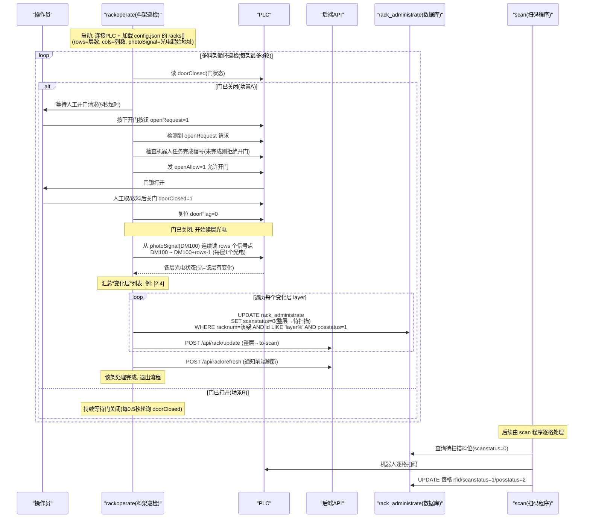
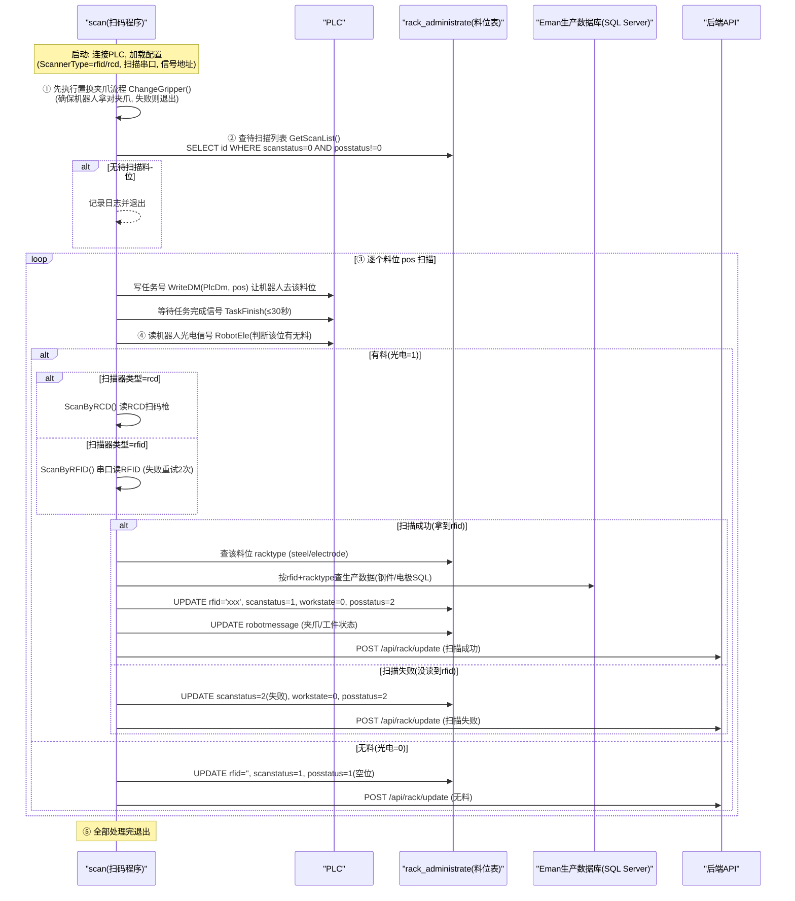

# 料架与扫码流程 · 系统说明文档

> 适用范围：`D:\桌面\erp\前后端分离`（后端 MachineMonitor + 前端 + 子程序 + 数据库）
> 说明：本文档总结料架（rack）、料架操作（rackoperate）、扫码（scan）的数据流与实机注意事项，基于当前代码与数据库实测整理。

---

## 1. 系统组成

| 角色 | 说明 |
|---|---|
| 后端 `MachineMonitor.exe` | HTTP 服务（端口 8888），Controller/Service/Repository 分层，启动时自动建库建表 |
| 前端 `web-ui/frontend` | 命令式模块化版本（`sections/*.js + main.js`）与 Vue 2 版本（`app.js`）双轨并存 |
| 子程序 | `load_machine` / `unload_machine` / `change_machine` / `prepare_material` / `rackoperate` / `scan` 等，通过 PLC 驱动设备、读写数据库 |
| 数据库 | MySQL `qianduantest`（当前测试库），连接配置在 `config.json` 的 `database` 段 |
| Eman 数据库 | SQL Server（`config.json` 的 `eman` 段），扫码后按 RFID 查询生产数据 |

---

## 2. 数据库：数据从哪里来

### 2.1 表结构定义位置

- 唯一定义处：`web-ui/backend/Repository/DatabaseRepository.cs`
- 启动时 `EnsureDatabaseAndTables()` 自动：
  1. 建库（不存在时）：`CREATE DATABASE IF NOT EXISTS ... utf8mb4`
  2. 建表（不存在时）：按 `requiredTables` 列表执行 `GetCreateTableSql()`
  3. 补列：`EnsureRackAdministrateColumns()` 检查并补 `materialname` / `programname`
- 后端**只建表，不插入任何基础数据**

### 2.2 数据来源分类

**① 台账数据（静态，需初始化脚本）——后端不自动生成**

| 表 | 内容 | 来源 |
|---|---|---|
| `macmessage` | 机床主表（编号/IP/状态） | 初始化脚本按 `config.json.machines` 插入 |
| `rack_administrate` | 料架料位（id=层*100+列，如 101=第1层第1列） | 初始化脚本按料架 `rows×cols` 生成 |
| `grippers` | 夹爪配置 | 初始化脚本按 `config.json.grippers` 插入 |
| `following_rack` | 随行台 | 初始化脚本插入 |
| `robotmessage` | 机器人初始状态（1 条空状态） | 初始化脚本插入 |

当前测试数据来自项目自带脚本 `plc-simulator/init_db.sql`（注释：`scan.exe 离线调试 - 数据库初始化脚本`），其中 `TEST_PART_001~008` 等是调试时被覆写的测试数据。

**② 运行数据（自动写入）**

| 表 | 写入方 | 时机 |
|---|---|---|
| `macmessage.workstate` | load/change/unload_machine | 上料/下料/换料时 UPDATE |
| `macworkposstatus` | load_machine | 上料时写工件名+状态；首次按 `stationCount` 自动补空工位行 |
| `rack_administrate` | scan / change_machine / unload_machine | 扫码写 RFID；放/取料更新 workstate |
| `process_status` | 后端 WorkflowService | 工作流启动/完成时写（当前为空=未跑过流程） |
| `workflow_log` | 后端 WorkflowService | 工作流每一步写审计日志 |

### 2.3 实机前必须注意

1. **没有"从 config.json 同步到数据库"的初始化逻辑**：换正式库后机床/料架/夹爪全空，需写生产初始化脚本。
2. **`macworkposstatus` 只在行数为 0 时补齐**（`EnsureMacWorkPosRows`）：配置从 4 工位改成 6 工位不会自动加行。
3. **`rack_administrate` 表里只有料位没有料架实体**：料架名称/类型/信号点只在 `config.json`，数据库仅用 `racknum` 区分所属料架，两者无自动同步。

---

## 3. 料架（Rack）是什么

三层含义：

| 层面 | 说明 |
|---|---|
| 物理 | 存放毛坯/工件的铁架，1 个料架 = N 层 × M 列格子阵列（如 6×6=36 格） |
| 配置 | `config.json` 的 `racks[]`：类型（steel/tool/electrode/pallet）、rows/cols、PLC 信号点（photoSignal 光电、openRequest 开门请求、doorClosed 门状态、grabStartTaskNo 抓取任务号等） |
| 数据库 | `rack_administrate` 每行 = 1 个料位，存 rfid / scanstatus / posstatus / workstate |

格子编号规则：`层号*100 + 列号`（`101`=第1层第1列，`606`=第6层第6列）。

---

## 4. rackoperate：层光电 → 整层待扫描

### 4.1 目的

用**最少的光电信号**，把"人开过一次门"可靠地翻译成"这几层需要重新扫码核实"，保证料架数据库状态在进入自动化加工前是真实的。

- 按层装光电（1 层 1 个点，只需 `rows` 个），不做逐格检测（便宜、快）
- 整层标 `scanstatus=0`（待扫描）是强制"重新确认"，防止脏状态流入加工
- 门开关是事件边界，不实时监控；格级确认交给 `scan`

### 4.2 不能做什么

- **不能自己识别料架有多少料位**：层数/列数完全来自 `config.json` 的 `rows/cols`
- **光电按层粒度，不感知具体哪个格**：某层任何一格有变化 → 整层标记待扫描
- 格级确认是 `scan` 的职责（粗检测 + 精确认两级分工）

### 4.3 时序图

---

## 5. scan：扫码流程

### 5.1 主流程（`scan/Program.cs`）

1. **置换夹爪** `ChangeGripper()`：确保机器人用对夹爪，失败则退出
2. **取待扫描列表** `GetScanList()`：`SELECT id FROM rack_administrate WHERE scanstatus=0 AND posstatus!=0 ORDER BY id`
3. **逐料位循环**：
   - `WriteDM(PlcDm, pos)` 发任务号让机器人到位
   - 等任务完成信号（≤30 秒）
   - 读机器人光电 `RobotEle` 判断有无料
4. **扫码结果三态**：
   - 有料 + 读到 → 写 `rfid`、`scanstatus=1`、查 Eman 生产数据、状态"待加工"
   - 有料 + 未读到 → `scanstatus=2`（扫描失败），提示人工处理
   - 无料 → 清空 `rfid`、`posstatus=1`（空位）
5. 每步通知后端 `/api/rack/update` 刷新前端

### 5.2 时序图

---

## 6. 扫码读取方式

由配置 `ScannerType` 决定（`rfid` 或 `rcd`）。

### 6.1 RFID（默认，串口）

- 底层：`web-ui/lib/SerialPort.dll` 的 `Serialoperate.ReadRfid`（**DLL 封装，无源码**）
- 接口：`Send(com)` 触发读取、`OpenScan()`/`CloseScan()`、串口数据事件
- 流程：`Send(RfidCom)` → 等 500ms → 取 `ReceiveData` → 空/`"null"` 重试最多 2 次

### 6.2 RCD 扫码枪（TCP 网络）

- 底层：`Rcd/Rcd/RCD_100.cs`（项目自带源码）
- **TCP 客户端 + 心跳保活 + 异步接收**：
  - 心跳线程：每 `RcdHeartbeatInterval` 秒发 `"heartbeat"`
  - 接收线程：每 300ms 检查 `DataAvailable`，读到数据 ASCII 解码后 `MessageSent` 事件上报
- 流程：等事件 5 秒 → 无效则暂停心跳 → 发 `"scan"` 触发扫码 → 继续心跳 → 再等 3 秒，重试最多 2 次
- 数据过滤：`"heartbeat"` 视为心跳包非扫码结果

### 6.3 对比

| | RFID（串口） | RCD（TCP） |
|---|---|---|
| 物理接口 | 串口 `RfidCom` | 网口 IP+端口 |
| 数据流 | 主动 `Send()` 问一次 → 等 500ms → 取结果 | 常连接，心跳保活，事件推送 |
| 超时/重试 | 最多重试 2 次 | 等 5s，发 `"scan"` 重试 2 次 |
| 数据过滤 | `"null"` 无效 | `"heartbeat"` 无效 |
| 可改性 | 协议在 DLL 内，不可改 | 协议在项目源码，可改 |

---

## 7. 实机检测方法

### 7.1 运行时逐条核对

| 检测项 | SQL | 判断标准 |
|---|---|---|
| 机床在线/空闲 | `SELECT id,workstate,status FROM macmessage` | 前端卡片显示 = 表里值 |
| 上料落库 | `SELECT mac_name,worknum,workpiece_name,workpiece_status FROM macworkposstatus` | 上料后对应工位出现工件名 |
| 当天加工统计 | `SELECT process_status,COUNT(*) FROM process_status WHERE DATE(process_start_time)=CURDATE() GROUP BY process_status` | 前端已加工数 = `process_status=2` 计数 |
| 流程走通 | `SELECT * FROM workflow_log ORDER BY id DESC LIMIT 20` | 每步应有对应日志 |

### 7.2 关键提醒

- 前端 dashboard 只读 `macmessage` 和 `process_status`，**不读 `macworkposstatus`**（工位明细只能 SQL 验证）
- `process_status` 为空 = 前端"已加工数"恒为 0，直到工作流真正跑过，**别当故障**
- 验证一致性最可靠：**手动触发一个动作（如对 1 号机上一件料）→ 立刻查 `macworkposstatus` + `workflow_log`**

---

## 8. 切换数据库注意事项

- 连接配置集中在 `config.json` 的 `database` 段（type/host/port/database/user/password），改库**无需改代码重新编译**
- 代码支持 `mysql` 和 `sqlserver`，但 SQL Server 分支建表 SQL 不完整（`rack_administrate`/`knife_rack`/`grippers`/`macworkposstatus` 等只在 MySQL 分支有定义）
- `EnsureRackAdministrateColumns` 用 `SHOW COLUMNS`（MySQL 语法）
- **若确定切 SQL Server，需先补齐 `DatabaseRepository.GetCreateTableSql()` 的 SQL Server 分支**

---

## 9. 待办建议

- [ ] 写生产初始化脚本（按实机 `config.json` 生成 `macmessage`/`rack_administrate`/`grippers`/`following_rack`/`robotmessage`）
- [ ] 定库后补齐 SQL Server 建表分支（如需切 SQL Server）
- [ ] 明确 `rack_administrate` 与 `config.json.racks` 的同步机制（配置增删料架时自动生成/清理料位行）